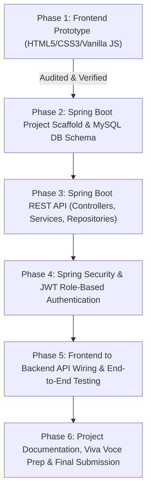

# ShelfSense - Smart Library Management System
### B.Tech Academic Capstone Project

ShelfSense is a full-stack, enterprise-grade Smart Library Management System designed for engineering colleges and universities.

---

## 🛠️ Technology Stack Architecture

| Layer | Technology | Status |
|---|---|---|
| **Frontend** | HTML5, CSS3, Vanilla JavaScript (ES6+) | ✅ **Phase 1 Complete (Audited Prototype)** |
| **Backend** | Java 17 / 21 with Spring Boot 3.x (Spring Web, Spring Data JPA, Spring Security) | ⏳ **Phase 2 (Next)** |
| **Database** | MySQL 8.x Relational Database | ⏳ **Phase 2 (Next)** |
| **Build & Dependency Tool** | Apache Maven | ⏳ **Phase 2 (Next)** |
| **IDE** | Antigravity IDE | Active |

---

## 🎨 Design Specification

- **Sidebar Background:** Deep Teal (`#123B3A`)
- **Primary Accent:** Teal (`#0F766E`)
- **Application Canvas:** Soft Light Neutral (`#F7F9FC`)
- **Containers:** Crisp White Cards (`#FFFFFF`) with subtle borders (`#E2E8F0`) and soft elevation
- **Typography:** Modern sans-serif (`Plus Jakarta Sans` / system stack)

---

## 🚀 Phase 1: Interactive Frontend Prototype

The Phase 1 prototype is 100% self-contained and ready to run in any browser with **zero external npm build steps**.

### How to Run:
1. Navigate to the project folder:
   ```
   c:\Users\rikky\OneDrive\smart library management system\frontend\
   ```
2. Double-click **`index.html`** to open it in your browser (Google Chrome, Microsoft Edge, Firefox, Brave).
3. Alternatively, if you have a local HTTP server:
   ```bash
   npx serve frontend
   # or
   python -m http.server 3000 --directory frontend
   ```

### Included Features in Phase 1:
1. **Role-Based Access Control (RBAC):**
   - Click the role toggle in the top-right header: **Librarian (Admin)** vs **Student (Member)**.
   - When switched to **Student**, administrative actions (adding books, circulation desk, member directory, audit reports) are hidden, showing personal student loans, quota status, and catalogue browsing.
2. **Dashboard Overview:**
   - Real-time KPI metric cards (Total Titles, Shelf Stock, Active Loans, Overdue Items, Unpaid Penalties).
   - Dynamic **Overdue Alert banner** with 1-click jump to defaulters or student loans.
   - Recent circulation stream and departmental inventory distribution progress bars.
3. **Interactive Shelf Map (Spatial Locator):**
   - Top-down visual floor plan for Ground Floor (Main Stacks & Reading Hall) and 1st Floor (Research & Digital Lab).
   - Real-time shelf rack highlighting (`CS-01`, `CS-02`, `MATH-01`, `PHY-01`, etc.) with animated beacon pins.
   - Live book search on the map with auto-suggest dropdown.
   - Turn-by-turn directions from the South Library Entrance to the target rack.
   - "Find on Shelf" one-click action integrated across Catalogue Book Cards and the ShelfSense Assistant.
   - Clear unassigned alert handling for institutional digital e-books.
4. **ShelfSense Smart Assistant:**
   - Floating AI assistant widget capable of answering natural-language queries about shelf locations, book stock, fine calculations, borrowing quotas, and renewal procedures using live library state.
5. **Searchable Book Catalogue:**
   - Live search across Title, Author, ISBN (with or without hyphens), Subject, and Shelf Location.
   - Category filtering (Computer Science, Mechanical, Electronics, Mathematics, etc.).
   - Stock status filtering (Available vs Issued Out).
   - Add new book modal, edit book, and delete validation (blocks deletion if copies are currently loaned out).
6. **Circulation Desk (Loans & Renewals):**
   - Issue book modal with loan quota enforcement (maximum 3 books for students, 6 for faculty).
   - Return book modal with **automated late penalty calculation** (₹5.00 / day).
   - Book renewal (+14 days extension).
7. **Member Directory:**
   - Student & Faculty records with roll numbers, departments, contact info, and active loan tracking.
8. **Accreditation & Audit Reports:**
   - Inventory summary, circulation activity log, and penalty audit ledger ready for print.
9. **Client-Side Persistence:**
   - Changes (new books, issued books, returns) save to browser `localStorage` and persist across page refreshes.
   - Includes a **"Reset Demo Data"** button in the sidebar footer to restore initial state at any time.

---

## 📋 Software Inspection & Prerequisites for Phase 2

During the workspace inspection on your machine, the following software status was identified:

| Software | Required Version | Current Status on Machine |
|---|---|---|
| **Java Development Kit (JDK)** | JDK 17 or JDK 21 (LTS) | ⚠️ **Not found in PATH** |
| **Apache Maven** | 3.8+ or 3.9+ | ⚠️ **Not found in PATH** (or can use `mvnw` Maven Wrapper) |
| **MySQL Server** | MySQL Community Server 8.x | ⚠️ **Not found in PATH** |

---

## 🗺️ Master Project Roadmap


